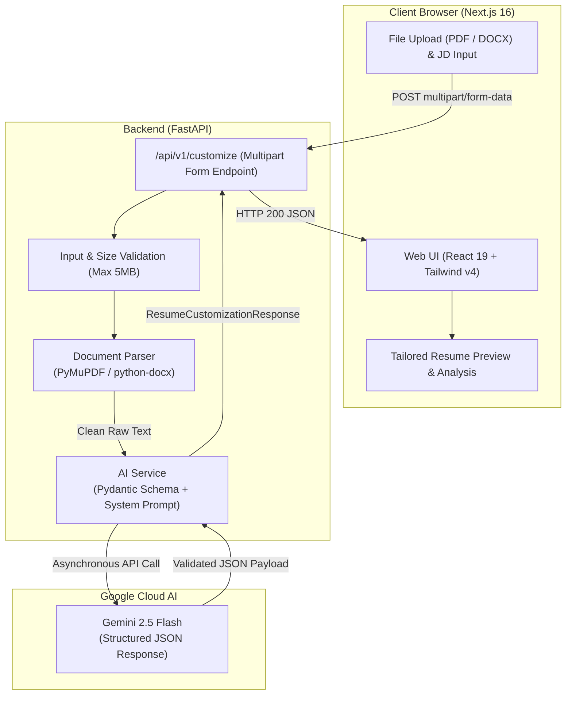

# ResumeCraft — AI Resume Customizer

An intelligent, full-stack application that tailors resumes to specific job descriptions with precision, keyword gap analysis, and ATS-friendly formatting powered by **Google Gemini 2.5 Flash** and **FastAPI**.

---

## 📌 Project Overview

Landing interviews in modern hiring requires aligning a resume with applicant tracking systems (ATS) and recruiter criteria without fabricating credentials. **ResumeCraft** automates this alignment responsibly:

- **Document Ingestion**: Extracts clean text from candidate resumes in **PDF** and **DOCX** formats.
- **Job Requirement Alignment**: Compares the candidate's authentic background against requirements, responsibilities, and qualifications in a target job description.
- **Truthful Tailoring**: Restructures the professional summary, highlights relevant competencies, and refines work experience bullets using only verifiable facts from the original resume.
- **Keyword Gap Analysis**: Identifies matched keywords already present and surfaces missing requirements as skill gaps—without falsely inventing them.
- **ATS Match Score**: Computes an estimated alignment score (0–100%) with actionable feedback and optimization suggestions.
- **Export Ready**: Preview the customized resume in an ATS-friendly layout with one-click copy to clipboard and `.txt` file export.

---

## 🛠️ Tech Stack Used

### **Frontend (`next-app/`)**
- **Framework**: [Next.js 16](https://nextjs.org/) (App Router, Server & Client Components)
- **Library**: [React 19](https://react.dev/)
- **Language**: [TypeScript](https://www.typescriptlang.org/)
- **Styling**: [Tailwind CSS v4](https://tailwindcss.com/)
- **UI Components & Icons**: [Lucide React](https://lucide.dev/), [Base UI](https://base-ui.com/), and [next-themes](https://github.com/pacocoursey/next-themes) (Dark/Light mode support)
- **API Client**: Native `fetch` with typed responses and error handling

### **Backend (`backend/`)**
- **Framework**: [FastAPI](https://fastapi.tiangolo.com/) (Asynchronous Python web framework)
- **ASGI Server**: [Uvicorn](https://www.uvicorn.org/)
- **Data Validation & Settings**: [Pydantic v2](https://docs.pydantic.dev/) and `pydantic-settings`
- **Document Parsers**:
  - [PyMuPDF (`fitz`)](https://pymupdf.readthedocs.io/): High-speed PDF text extraction
  - [`python-docx`](https://python-docx.readthedocs.io/): Word document paragraph and table parsing
- **LLM SDK**: Official [`google-genai`](https://github.com/googleapis/python-genai) SDK

---

## 🤖 LLM Provider and Model Used

| Property | Configuration |
| :--- | :--- |
| **Provider** | [Google AI Studio / Google GenAI](https://ai.google.dev/) |
| **Model** | **`gemini-2.5-flash`** (configurable via `GEMINI_MODEL`) |
| **SDK** | `google-genai` (async client via `client.aio.models.generate_content`) |
| **Output Mode** | Structured JSON schema validation (`response_mime_type="application/json"` with Pydantic response schema) |
| **Temperature** | `0.2` (Low temperature for factual adherence and deterministic output) |

### Anti-Hallucination & Safety Principles
The system prompt strictly commands the model to:
1. **Never fabricate experience**: Zero tolerance for invented job titles, employers, dates, degrees, metrics, or technical skills.
2. **Distinct Gap Reporting**: Missing job keywords are categorized separately under `missing_keywords` as actionable gaps, never added as fake candidate skills.
3. **Prompt Injection Defense**: Resume and job description documents are isolated within XML-style boundary tags and treated strictly as untrusted data.

---

## 🏗️ Architecture Diagram & Data Flow



### Architectural Highlights
1. **Separation of Concerns**: The frontend handles file picking, drag-and-drop validation, and reactive rendering; the backend orchestrates text extraction, sanitization, and structured AI generation.
2. **Schema Enforcement**: Both client and server share unified TypeScript and Pydantic interfaces (`TailoredResume`, `CustomizationResult`).
3. **Stateless & Private**: Documents are processed in memory and never permanently stored on disk or in a database.

---

## 🚀 Setup and Run Instructions (Local)

### Prerequisites
- **Node.js**: version `18.x` or higher ([Download Node.js](https://nodejs.org/))
- **Python**: version `3.10` or higher ([Download Python](https://www.python.org/))
- **Gemini API Key**: Obtain a free API key from [Google AI Studio](https://aistudio.google.com/)

---

### 1. Clone the Repository

```bash
git clone https://github.com/AgarwalVaibhav-20/Resume-Customizer-.git
cd Resume-Customizer-
```

---

### 2. Backend Setup (FastAPI)

1. Open a terminal and navigate to the `backend` folder:
   ```bash
   cd backend
   ```

2. Create and activate a Python virtual environment:
   - **Windows (PowerShell)**:
     ```powershell
     python -m venv venv
     .\venv\Scripts\Activate.ps1
     ```
   - **macOS / Linux**:
     ```bash
     python3 -m venv venv
     source venv/bin/activate
     ```

3. Install required Python packages:
   ```bash
   pip install -r requirements.txt
   ```

4. Create your local environment configuration:
   ```bash
   cp .env.example .env
   ```
   Open `.env` in your text editor and insert your Gemini API key:
   ```env
   GEMINI_API_KEY=your_actual_gemini_api_key_here
   GEMINI_MODEL=gemini-2.5-flash
   FRONTEND_ORIGIN=http://localhost:3000
   MAX_UPLOAD_SIZE_MB=5
   ```

5. Start the backend server:
   ```bash
   uvicorn app.main:app --reload --port 8000
   ```
   The backend API will be live at `http://127.0.0.1:8000`. You can inspect the interactive OpenAPI documentation at `http://127.0.0.1:8000/docs`.

---

### 3. Frontend Setup (Next.js)

1. Open a **second terminal** and navigate to the `next-app` folder:
   ```bash
   cd next-app
   ```

2. Install Node dependencies:
   ```bash
   npm install
   ```

3. Configure frontend environment variables (optional for default `http://127.0.0.1:8000`):
   ```bash
   cp .env.example .env.local
   ```

4. Start the Next.js development server:
   ```bash
   npm run dev
   ```

5. Open your browser and navigate to:
   ```text
   http://localhost:3000
   ```

---

### 4. Running the Application
1. Click **"Sample JD"** or paste your own job description (minimum 50 characters).
2. Upload your current resume in **PDF** or **DOCX** format (up to 5 MB).
3. Click **"Customize My Resume"**.
4. Review your estimated ATS match score, keyword gaps, tailored resume preview, and AI improvement suggestions.
5. Click **"Copy Resume"** or **"Download (.txt)"** to export your tailored resume.

---

## ⚠️ Known Limitations & Trade-Offs

1. **Scanned / Image-only PDFs**:
   - *Limitation*: PyMuPDF extracts text streams from standard digital documents. Scanned resumes that contain only images without an underlying OCR layer will return a `"No readable text found"` error.
   - *Trade-off*: Keeps the backend lightweight and fast without heavyweight OCR engines (like Tesseract); users must upload digital text PDFs or DOCX files.

2. **In-Memory & Stateless Operation**:
   - *Limitation*: No database is currently attached. Uploaded resumes and customization results are not persisted across browser refreshes.
   - *Trade-off*: Enhances candidate privacy and eliminates database hosting costs, but requires users to download or copy their results immediately.

3. **Export Formats**:
   - *Limitation*: The application currently exports to formatted plain text (`.txt`) and clipboard. Direct PDF/DOCX re-compilation with custom visual templates is not yet implemented.
   - *Trade-off*: Plain text formatting is universally accepted by all ATS parsers without risking formatting or column corruption.

4. **LLM Match Score Approximation**:
   - *Limitation*: The match score (0–100%) is an LLM semantic heuristic evaluating resume evidence against stated qualifications. It is not an exact replica of proprietary algorithms (e.g., Taleo, Workday, Greenhouse).

5. **API Rate Limits**:
   - *Limitation*: Free tier Gemini API keys are subject to request-per-minute (RPM) limits. High concurrent traffic requires a paid Google Cloud project quota.

---

## 📄 License

This project is open-source under the [MIT License](LICENSE).
